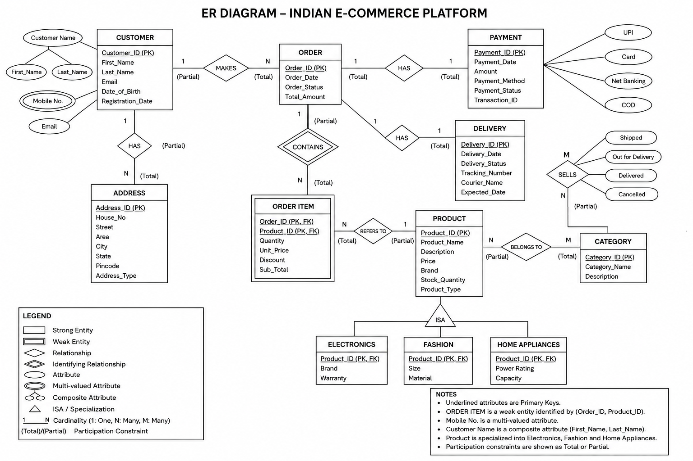

# Experiment 1 — ER Diagram: Indian E-Commerce Platform

**Name:** ANIKET &nbsp;|&nbsp; **Roll No:** 25LBCS3174

## Aim

To design an **ER diagram** for an Indian e-commerce platform containing Customer, Address, Order, OrderItem, Seller, Product, Category, Payment, and Delivery. The diagram demonstrates keys, a multivalued attribute, a weak entity, product specialization, cardinalities, and participation constraints.

## ER Diagram

## ER Notation

| Symbol | Meaning |
|--------|---------|
| Rectangle | Strong entity |
| Double rectangle | Weak entity |
| Oval | Attribute |
| Double oval | Multivalued attribute |
| Diamond | Relationship |
| Double diamond | Identifying relationship |
| Underlined attribute | Primary key |
| Triangle | ISA / specialization |
| 1:1 | One-to-one |
| 1:N | One-to-many |
| M:N | Many-to-many |

## Full Report

The complete lab record (diagram, notation, and result) is available in [`Experiment_1_ER_Diagram.pdf`](Experiment_1_ER_Diagram.pdf).

## Result

The ER diagram for the Indian e-commerce platform was designed with the required entities, attributes, relationships, cardinalities, weak entity, multivalued attribute, and product specialization.
