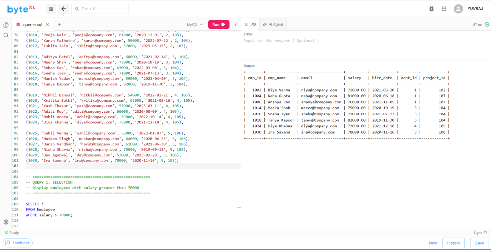
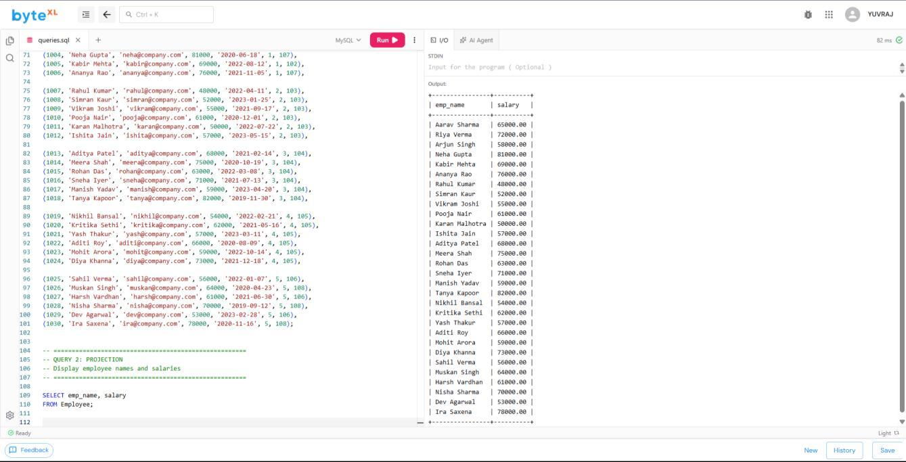
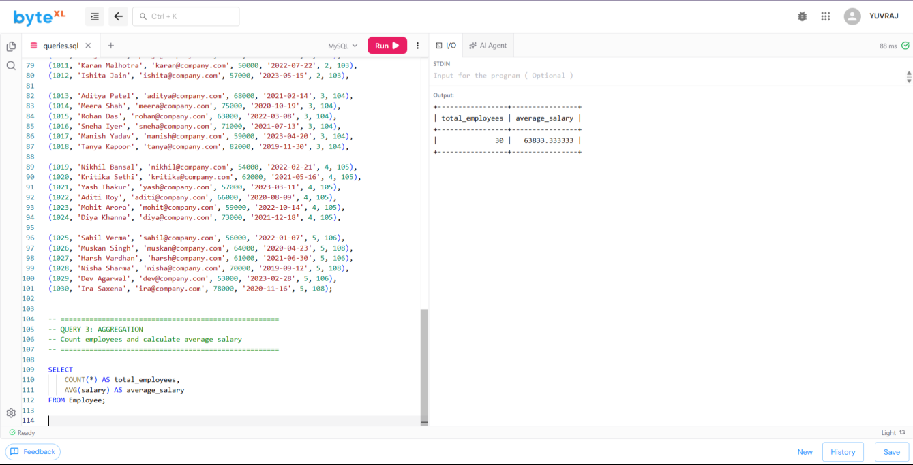
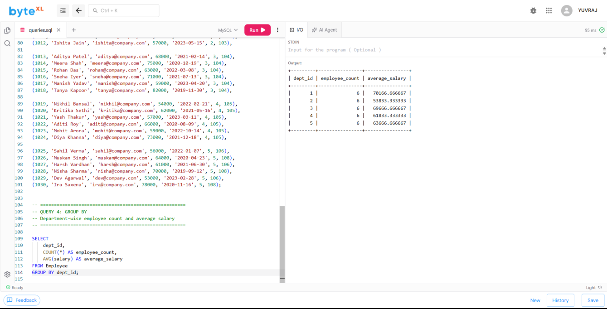
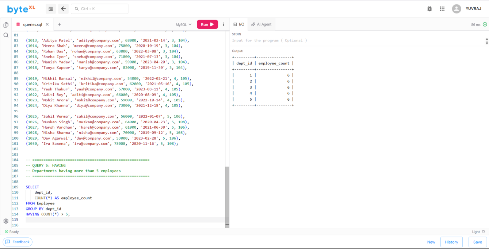
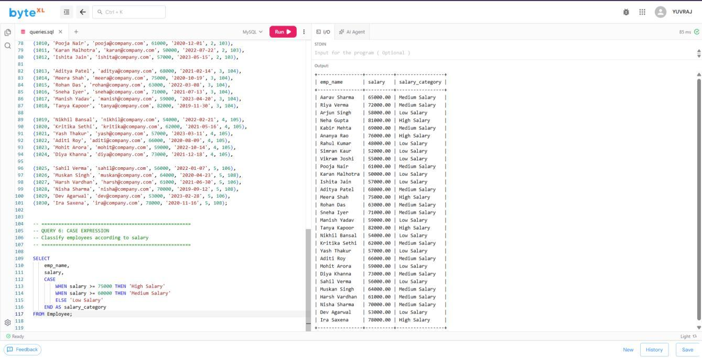
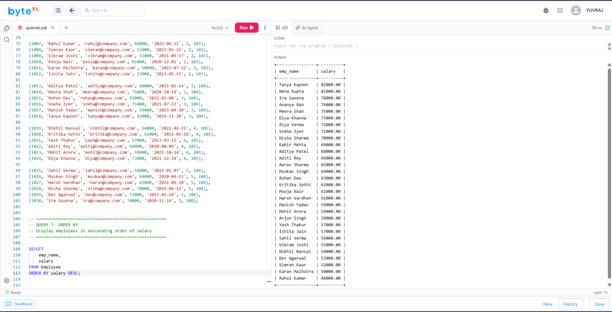
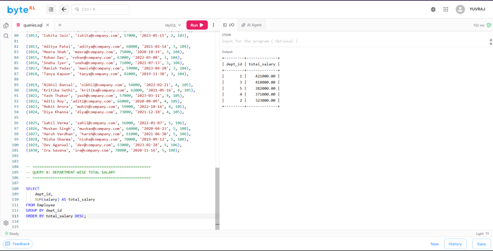
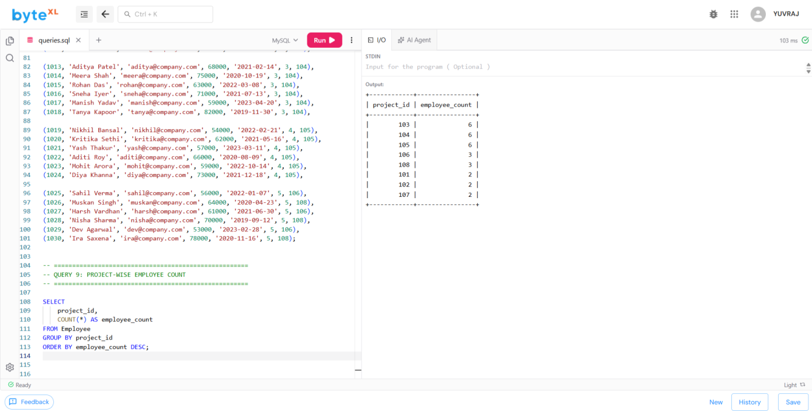
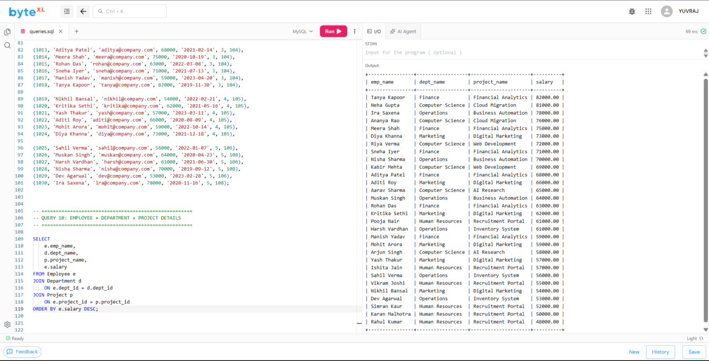

# Experiment 3 — SQL Queries on Employee–Department–Project Database

**Name:** ANIKET &nbsp;|&nbsp; **Roll No:** 25LBCS3174

## Aim

To create an Employee–Department–Project database schema, insert at least 30 employees across 5 departments and 8 projects, and execute SQL queries demonstrating **selection, projection, aggregation, GROUP BY, HAVING, CASE expressions, and ORDER BY**.

## Description

This experiment demonstrates the use of SQL for managing and analyzing data stored in an Employee–Department–Project schema. The database contains **five departments**, **eight projects**, and **thirty employees** distributed among the departments and projects.

The experiment covers important SQL operations including:

- **Selection** using `WHERE`
- **Projection** using `SELECT`
- **Aggregation** using functions such as `COUNT`, `AVG`, `SUM`, and `MAX`
- Grouping records using `GROUP BY`
- Filtering grouped results using `HAVING`
- Conditional classification using `CASE` expressions
- Sorting query results using `ORDER BY`

The schema uses primary keys and foreign keys to maintain relationships between departments, employees, and projects. The queries help generate useful reports such as department-wise employee counts, average salaries, project assignments, salary classifications, and departments satisfying specified conditions.

## Files

| File | Description |
|------|-------------|
| [`exp3_employee_department_project.sql`](exp3_employee_department_project.sql) | Complete SQL code base (schema + data + all 10 queries) |
| [`ANIKET03.pdf`](ANIKET03.pdf) | Original lab record PDF |
| [`outputs/`](outputs/) | Output screenshots of every query |

## Schema

- **Department** (`dept_id` PK, `dept_name`, `location`)
- **Project** (`project_id` PK, `project_name`, `budget`, `dept_id` FK → Department)
- **Employee** (`emp_id` PK, `emp_name`, `email`, `salary`, `hire_date`, `dept_id` FK → Department, `project_id` FK → Project)

## Source Code

The full code is in [`exp3_employee_department_project.sql`](exp3_employee_department_project.sql). Key queries:

### 1. Selection — employees with salary greater than 70000

```sql
SELECT *
FROM Employee
WHERE salary > 70000;
```

### 2. Projection — employee names and salaries

```sql
SELECT emp_name, salary
FROM Employee;
```

### 3. Aggregation — count employees and calculate average salary

```sql
SELECT COUNT(*) AS total_employees,
       AVG(salary) AS average_salary
FROM Employee;
```

### 4. GROUP BY — department-wise employee count and average salary

```sql
SELECT dept_id,
       COUNT(*) AS employee_count,
       AVG(salary) AS average_salary
FROM Employee
GROUP BY dept_id;
```

### 5. HAVING — departments having more than 5 employees

```sql
SELECT dept_id,
       COUNT(*) AS employee_count
FROM Employee
GROUP BY dept_id
HAVING COUNT(*) > 5;
```

### 6. CASE expression — classify employees according to salary

```sql
SELECT emp_name,
       salary,
       CASE
           WHEN salary >= 75000 THEN 'High Salary'
           WHEN salary >= 60000 THEN 'Medium Salary'
           ELSE 'Low Salary'
       END AS salary_category
FROM Employee;
```

### 7. ORDER BY — employees in descending order of salary

```sql
SELECT emp_name, salary
FROM Employee
ORDER BY salary DESC;
```

### 8. Department-wise total salary

```sql
SELECT dept_id,
       SUM(salary) AS total_salary
FROM Employee
GROUP BY dept_id
ORDER BY total_salary DESC;
```

### 9. Project-wise employee count

```sql
SELECT project_id,
       COUNT(*) AS employee_count
FROM Employee
GROUP BY project_id
ORDER BY employee_count DESC;
```

### 10. Employees with department and project details (JOIN)

```sql
SELECT e.emp_name,
       d.dept_name,
       p.project_name,
       e.salary
FROM Employee e
JOIN Department d ON e.dept_id = d.dept_id
JOIN Project p ON e.project_id = p.project_id
ORDER BY e.salary DESC;
```

## Output

### 1. Selection — salary > 70000



### 2. Projection — name and salary



### 3. Aggregation — COUNT and AVG



### 4. GROUP BY — department-wise count and average salary



### 5. HAVING — departments with more than 5 employees



### 6. CASE — salary classification



### 7. ORDER BY — salary descending



### 8. Department-wise total salary



### 9. Project-wise employee count



### 10. Employee–Department–Project join



## Result

The Employee–Department–Project database was created with 5 departments, 8 projects, and 30 employees, and all SQL queries demonstrating selection, projection, aggregation, GROUP BY, HAVING, CASE expressions, and ORDER BY were executed successfully.
