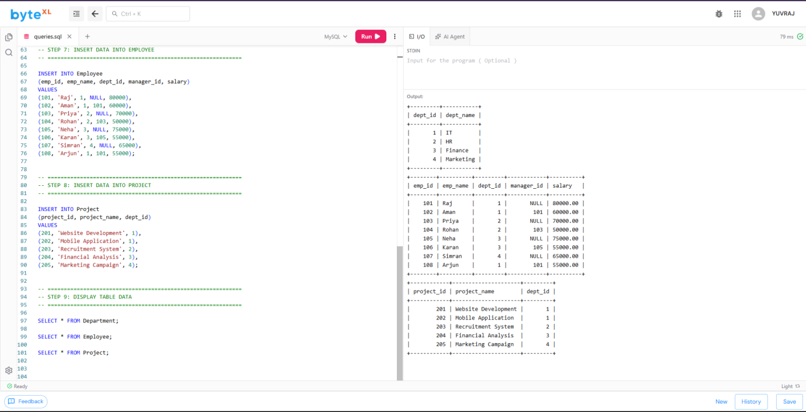
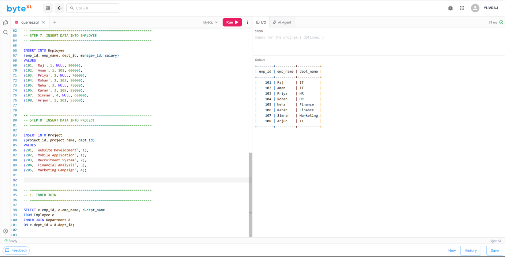
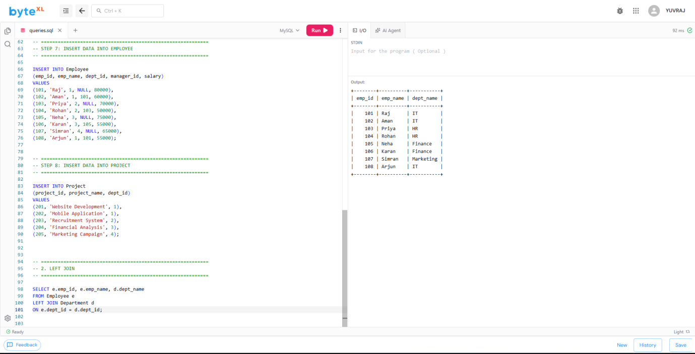
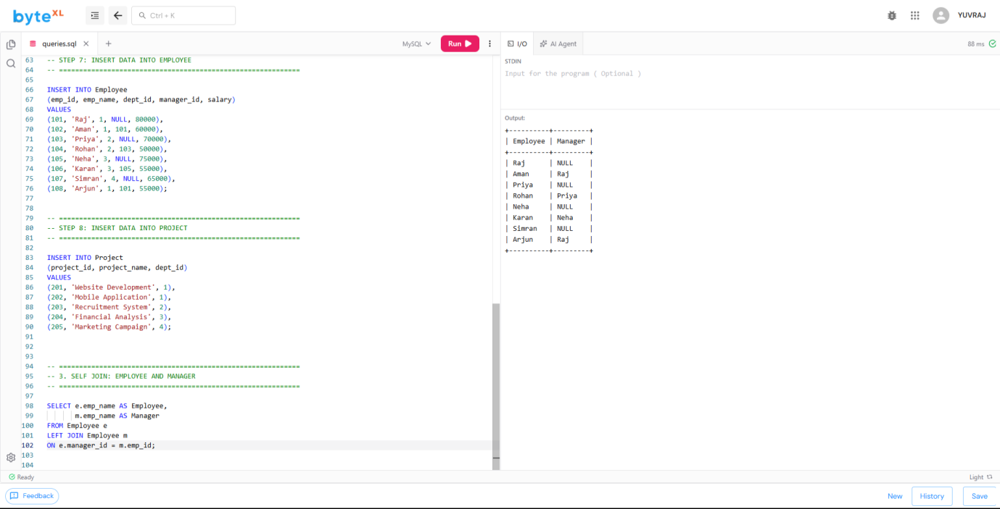
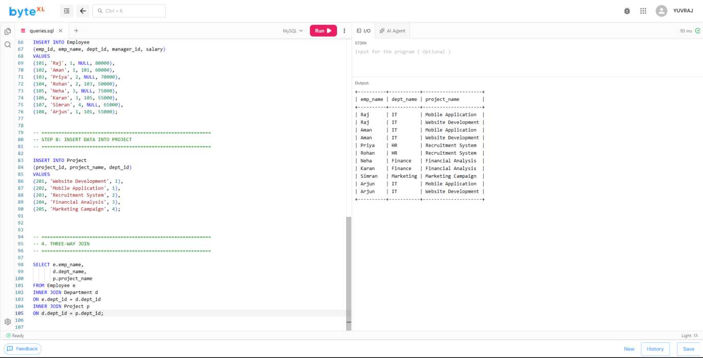
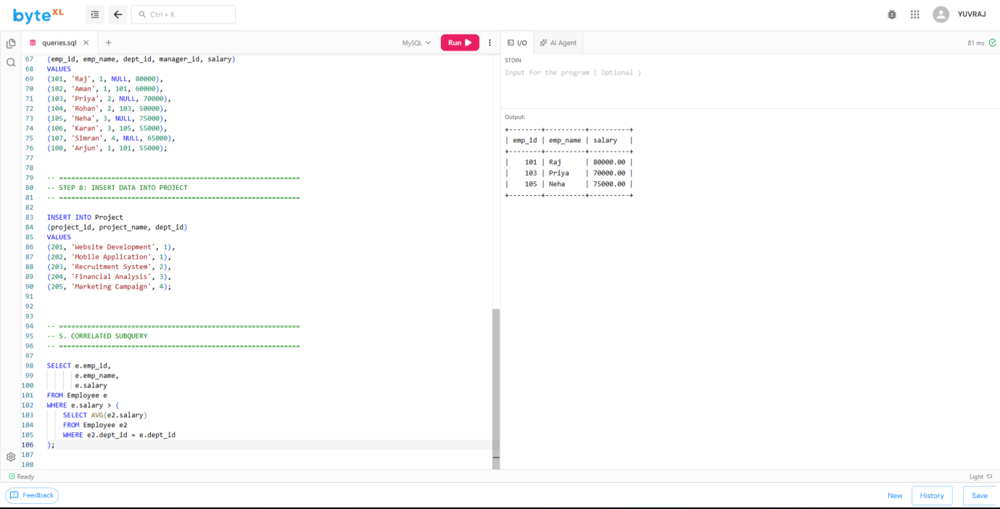
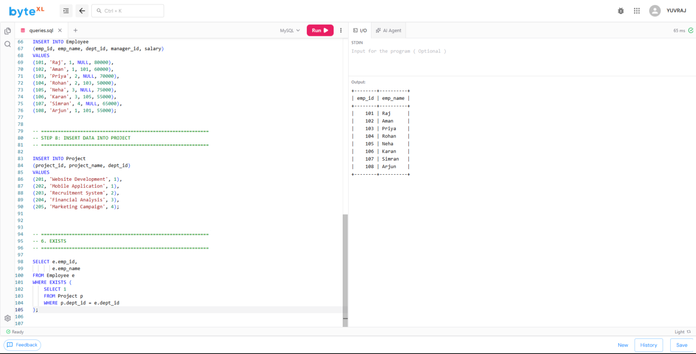
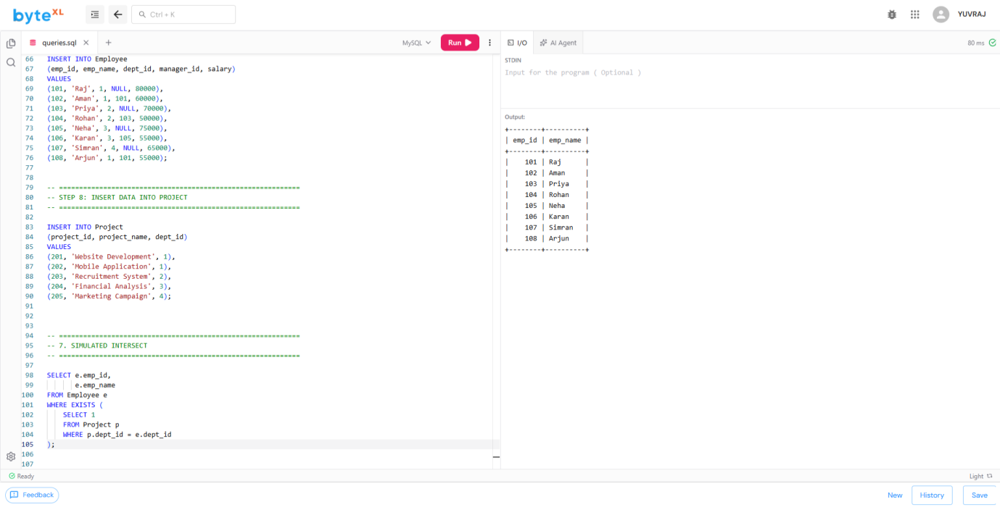
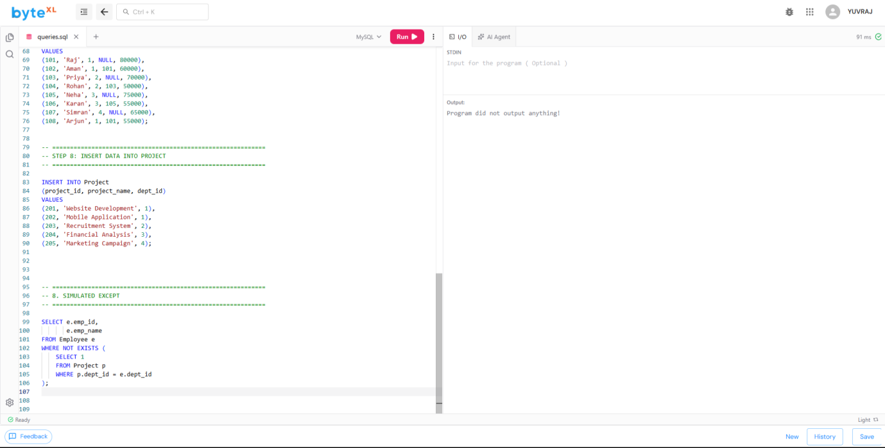
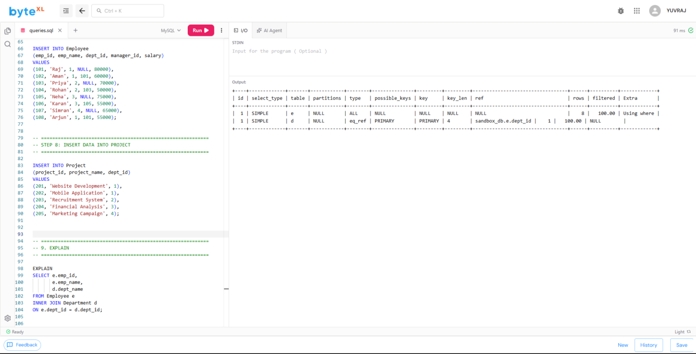

# Experiment 4 — Joins, Subqueries, Set Operations and EXPLAIN

**Name:** ANIKET &nbsp;|&nbsp; **Roll No:** 25LBCS3174

## Aim

To write and execute SQL queries using the Employee schema with **INNER JOIN, LEFT JOIN, self-join, 3-way join, correlated subqueries, EXISTS, simulated INTERSECT, and EXCEPT**, and to compare execution plans using **EXPLAIN**.

## Description

This experiment demonstrates different SQL techniques for retrieving and comparing data from the Employee schema. JOIN operations are used to combine related records from multiple tables. An **INNER JOIN** returns only matching records, while a **LEFT JOIN** returns all records from the left table along with matching records from the right table. A **self-join** is used when a table is joined with itself, such as when employees are related to their managers.

A **3-way join** combines three related tables in a single query. **Correlated subqueries** execute with reference to values from the outer query. **EXISTS** checks whether a related record exists, while simulated **INTERSECT** and **EXCEPT** operations can be achieved using `EXISTS` or `NOT EXISTS` when direct set operators are unavailable. **EXPLAIN** is used to view the query execution plan and understand how the database engine processes a query.

## Files

| File | Description |
|------|-------------|
| [`exp4_joins_subqueries_explain.sql`](exp4_joins_subqueries_explain.sql) | Complete SQL code base (schema + data + all queries) |
| [`ANIKET04.pdf`](ANIKET04.pdf) | Original lab record PDF |
| [`outputs/`](outputs/) | Output screenshots of every query |

## Schema

Database `DBMS_LAB`:

- **Department** (`dept_id` PK, `dept_name`)
- **Employee** (`emp_id` PK, `emp_name`, `dept_id`, `manager_id`, `salary`)
- **Project** (`project_id` PK, `project_name`, `dept_id`)

Sample data: 4 departments, 8 employees (with manager relationships), 5 projects.

## Source Code

The full code is in [`exp4_joins_subqueries_explain.sql`](exp4_joins_subqueries_explain.sql). Key queries:

### 1. INNER JOIN

```sql
SELECT e.emp_id, e.emp_name, d.dept_name
FROM Employee e
INNER JOIN Department d
ON e.dept_id = d.dept_id;
```

### 2. LEFT JOIN

```sql
SELECT e.emp_id, e.emp_name, d.dept_name
FROM Employee e
LEFT JOIN Department d
ON e.dept_id = d.dept_id;
```

### 3. SELF JOIN — employee and manager

```sql
SELECT e.emp_name AS Employee,
       m.emp_name AS Manager
FROM Employee e
LEFT JOIN Employee m
ON e.manager_id = m.emp_id;
```

### 4. THREE-WAY JOIN

```sql
SELECT e.emp_name,
       d.dept_name,
       p.project_name
FROM Employee e
INNER JOIN Department d
ON e.dept_id = d.dept_id
INNER JOIN Project p
ON d.dept_id = p.dept_id;
```

### 5. CORRELATED SUBQUERY — employees earning above their department average

```sql
SELECT e.emp_id,
       e.emp_name,
       e.salary
FROM Employee e
WHERE e.salary > (
    SELECT AVG(e2.salary)
    FROM Employee e2
    WHERE e2.dept_id = e.dept_id
);
```

### 6. EXISTS

```sql
SELECT e.emp_id,
       e.emp_name
FROM Employee e
WHERE EXISTS (
    SELECT 1
    FROM Project p
    WHERE p.dept_id = e.dept_id
);
```

### 7. SIMULATED INTERSECT

```sql
SELECT e.emp_id,
       e.emp_name
FROM Employee e
WHERE EXISTS (
    SELECT 1
    FROM Project p
    WHERE p.dept_id = e.dept_id
);
```

### 8. SIMULATED EXCEPT

```sql
SELECT e.emp_id,
       e.emp_name
FROM Employee e
WHERE NOT EXISTS (
    SELECT 1
    FROM Project p
    WHERE p.dept_id = e.dept_id
);
```

### 9. EXPLAIN — view the execution plan

```sql
EXPLAIN
SELECT e.emp_id,
       e.emp_name,
       d.dept_name
FROM Employee e
INNER JOIN Department d
ON e.dept_id = d.dept_id;
```

## Output

### 1. INNER JOIN



### 2. LEFT JOIN



### 3. SELF JOIN — employee and manager



### 4. THREE-WAY JOIN



### 5. CORRELATED SUBQUERY



### 6. EXISTS



### 7. SIMULATED INTERSECT



### 8. SIMULATED EXCEPT



### 9. EXPLAIN — execution plan





## Result

All join types (INNER, LEFT, self, 3-way), correlated subqueries, EXISTS-based simulated INTERSECT/EXCEPT, and EXPLAIN execution plans were executed successfully on the Employee schema.
