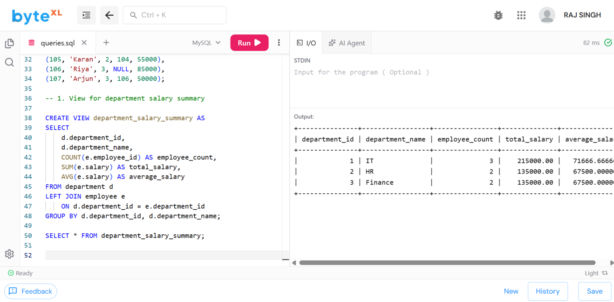
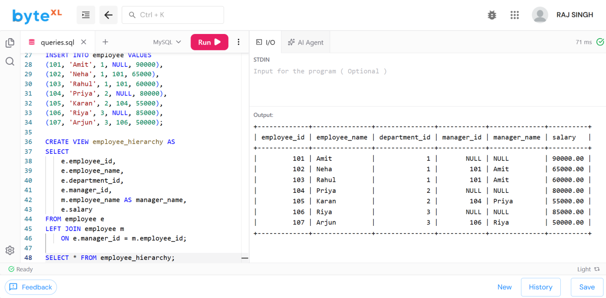
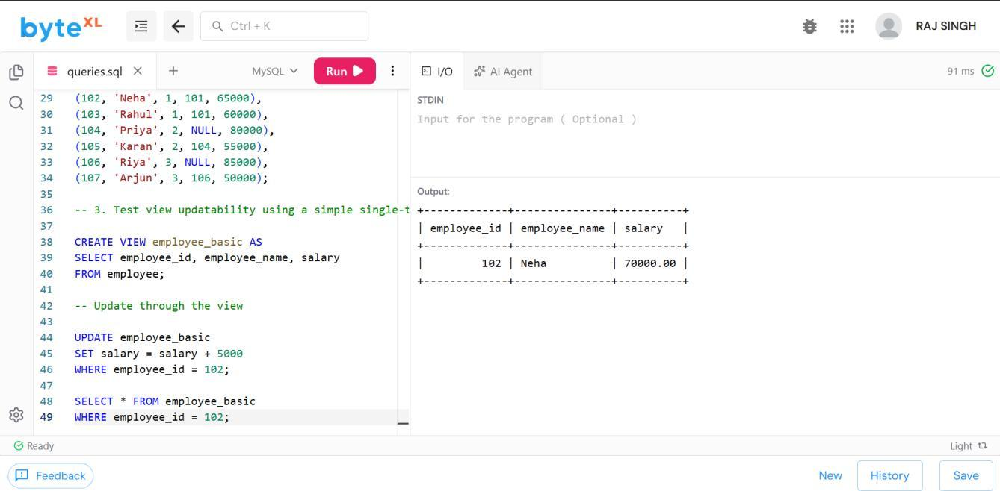
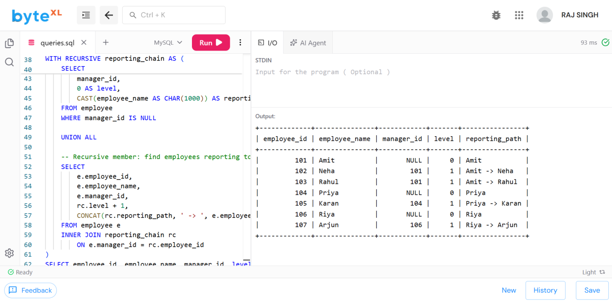

# Experiment 5 — Views, View Updatability and Recursive CTE

**Name:** ANIKET &nbsp;|&nbsp; **Roll No:** 25LBCS3174

## Aim

To create SQL **views** for department salary summary and employee hierarchy, test the **updatability** of views, and implement a **recursive CTE** to display reporting chains.

## Description

A SQL **view** is a virtual table based on the result of a SELECT query. Views are useful for presenting selected data, simplifying complex queries, and providing controlled access to database information.

In this experiment, two views are created. The first view, `department_salary_summary`, groups employees by department and displays the number of employees, total salary, and average salary. The second view, `employee_hierarchy`, displays employee details together with their manager information. The updatability of a simple employee view is then tested using an `UPDATE` statement.

A **recursive Common Table Expression (CTE)** is also implemented to display the complete reporting chain of employees. The recursive CTE starts from top-level employees who do not report to another employee and repeatedly joins employees with their managers.

> The following SQL uses **MySQL 8.0 or later** syntax because recursive CTEs require support for `WITH RECURSIVE`.

## Files

| File | Description |
|------|-------------|
| [`exp5_views_recursive_cte.sql`](exp5_views_recursive_cte.sql) | Complete SQL code base (tables + views + recursive CTE) |
| [`ANIKET05.pdf`](ANIKET05.pdf) | Original lab record PDF |
| [`outputs/`](outputs/) | Output screenshots |

## Schema

- **department** (`department_id` PK, `department_name`)
- **employee** (`employee_id` PK, `employee_name`, `department_id` FK → department, `manager_id` FK → employee, `salary`)

Sample data: 3 departments and 7 employees in a manager hierarchy.

## Source Code

The full code is in [`exp5_views_recursive_cte.sql`](exp5_views_recursive_cte.sql). Key statements:

### 1. View for department salary summary

```sql
CREATE VIEW department_salary_summary AS
SELECT
    d.department_id,
    d.department_name,
    COUNT(e.employee_id) AS employee_count,
    SUM(e.salary) AS total_salary,
    AVG(e.salary) AS average_salary
FROM department d
LEFT JOIN employee e
    ON d.department_id = e.department_id
GROUP BY d.department_id, d.department_name;

SELECT * FROM department_salary_summary;
```

### 2. View for employee hierarchy

```sql
CREATE VIEW employee_hierarchy AS
SELECT
    e.employee_id,
    e.employee_name,
    e.department_id,
    e.manager_id,
    m.employee_name AS manager_name,
    e.salary
FROM employee e
LEFT JOIN employee m
    ON e.manager_id = m.employee_id;

SELECT * FROM employee_hierarchy;
```

### 3. Test view updatability using a simple single-table view

```sql
CREATE VIEW employee_basic AS
SELECT employee_id, employee_name, salary
FROM employee;

UPDATE employee_basic
SET salary = salary + 5000
WHERE employee_id = 102;

SELECT * FROM employee_basic
WHERE employee_id = 102;
```

### 4. Recursive CTE to display reporting chains

```sql
WITH RECURSIVE reporting_chain AS (
    -- Anchor member: top-level employees
    SELECT
        employee_id,
        employee_name,
        manager_id,
        0 AS level,
        CAST(employee_name AS CHAR(1000)) AS reporting_path
    FROM employee
    WHERE manager_id IS NULL

    UNION ALL

    -- Recursive member: find employees reporting to each employee
    SELECT
        e.employee_id,
        e.employee_name,
        e.manager_id,
        rc.level + 1,
        CONCAT(rc.reporting_path, ' -> ', e.employee_name)
    FROM employee e
    INNER JOIN reporting_chain rc
        ON e.manager_id = rc.employee_id
)
SELECT
    employee_id,
    employee_name,
    manager_id,
    level,
    reporting_path
FROM reporting_chain
ORDER BY reporting_path;
```

## Output

### Screenshot 1: Department Salary Summary



### Screenshot 2: Employee Hierarchy



### Screenshot 3: View Updatability Test



### Screenshot 4: Recursive CTE Reporting Chain



## Result

The `department_salary_summary` and `employee_hierarchy` views were created successfully, the update through the simple view was applied correctly, and the recursive CTE displayed the complete reporting chains of all employees.
