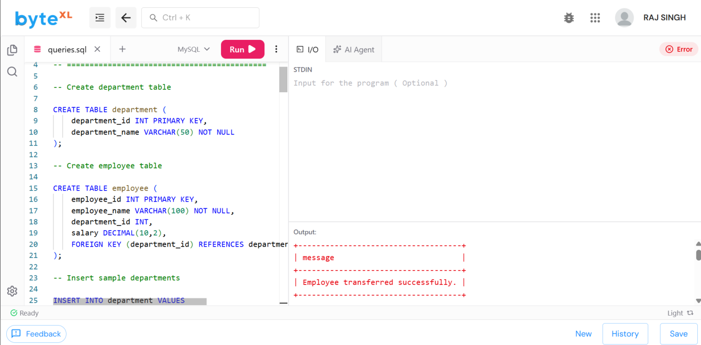
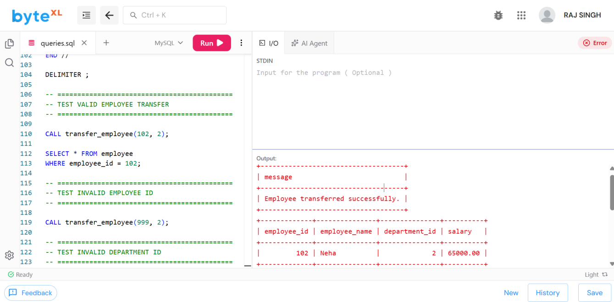
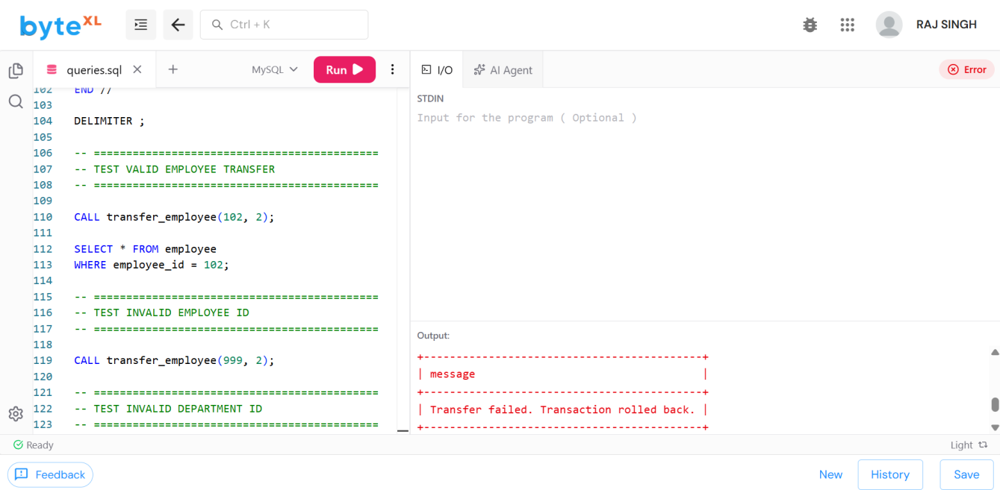
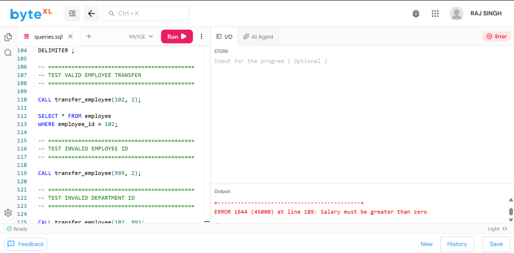

# Experiment 6 — Stored Procedures and Triggers

**Name:** ANIKET &nbsp;|&nbsp; **Roll No:** 25LBCS3174

## Aim

To create a stored procedure **`transfer_employee(emp_id, new_dept_id)`** with validation and error handling, and to implement database **triggers** for salary validation and audit logging.

## Description

A **stored procedure** is a precompiled collection of SQL statements that can be executed as a single unit. In this experiment, a stored procedure named `transfer_employee` is used to transfer an employee from one department to another. The procedure accepts an employee ID and a new department ID as parameters.

The procedure validates whether the employee exists and whether the destination department exists before performing the transfer. **Transaction control and error handling** are used so that the operation is rolled back if an error occurs.

**Triggers** are special database programs that execute automatically when specified events occur on a table. A salary validation trigger is implemented to prevent invalid or negative salary values. An **audit trigger** records salary changes in a separate audit table so that changes can be tracked.

The experiment tests valid transfers, invalid employee IDs, invalid department IDs, invalid salary values, and salary update auditing.

> The following SQL uses **MySQL 8.0 or later**.

## Files

| File | Description |
|------|-------------|
| [`exp6_stored_procedures_triggers.sql`](exp6_stored_procedures_triggers.sql) | Complete SQL code base (tables + procedure + triggers + tests) |
| [`ANIKET06.pdf`](ANIKET06.pdf) | Original lab record PDF |
| [`outputs/`](outputs/) | Output screenshots |

## Schema

- **department** (`department_id` PK, `department_name`)
- **employee** (`employee_id` PK, `employee_name`, `department_id` FK → department, `salary`)
- **salary_audit** (`audit_id` PK auto-increment, `employee_id`, `old_salary`, `new_salary`, `changed_at`)

Sample data: 3 departments and 4 employees.

## Source Code

The full code is in [`exp6_stored_procedures_triggers.sql`](exp6_stored_procedures_triggers.sql). Key components:

### 1. Stored procedure `transfer_employee` with validation and error handling

```sql
DELIMITER //

CREATE PROCEDURE transfer_employee(
    IN emp_id INT,
    IN new_dept_id INT
)
BEGIN
    DECLARE employee_count INT DEFAULT 0;
    DECLARE department_count INT DEFAULT 0;

    -- Error handler
    DECLARE EXIT HANDLER FOR SQLEXCEPTION
    BEGIN
        ROLLBACK;
        SELECT 'Transfer failed. Transaction rolled back.' AS message;
    END;

    START TRANSACTION;

    -- Validate employee
    SELECT COUNT(*) INTO employee_count
    FROM employee
    WHERE employee_id = emp_id;

    IF employee_count = 0 THEN
        SIGNAL SQLSTATE '45000'
        SET MESSAGE_TEXT = 'Employee does not exist';
    END IF;

    -- Validate department
    SELECT COUNT(*) INTO department_count
    FROM department
    WHERE department_id = new_dept_id;

    IF department_count = 0 THEN
        SIGNAL SQLSTATE '45000'
        SET MESSAGE_TEXT = 'Department does not exist';
    END IF;

    -- Transfer employee
    UPDATE employee
    SET department_id = new_dept_id
    WHERE employee_id = emp_id;

    COMMIT;

    SELECT 'Employee transferred successfully.' AS message;
END //

DELIMITER ;
```

**Test cases:**

```sql
CALL transfer_employee(102, 2);   -- valid transfer
CALL transfer_employee(999, 2);   -- invalid employee ID  -> error
CALL transfer_employee(102, 99);  -- invalid department ID -> error
```

### 2. Salary validation triggers (BEFORE INSERT / BEFORE UPDATE)

```sql
CREATE TRIGGER validate_salary_before_insert
BEFORE INSERT ON employee
FOR EACH ROW
BEGIN
    IF NEW.salary <= 0 THEN
        SIGNAL SQLSTATE '45000'
        SET MESSAGE_TEXT = 'Salary must be greater than zero';
    END IF;
END //
```

An identical trigger `validate_salary_before_update` is defined for `BEFORE UPDATE`.

**Test:** `UPDATE employee SET salary = -5000 WHERE employee_id = 101;` → rejected.

### 3. Salary audit trigger (AFTER UPDATE)

```sql
CREATE TRIGGER salary_audit_after_update
AFTER UPDATE ON employee
FOR EACH ROW
BEGIN
    IF OLD.salary <> NEW.salary THEN
        INSERT INTO salary_audit
        (employee_id, old_salary, new_salary)
        VALUES
        (OLD.employee_id, OLD.salary, NEW.salary);
    END IF;
END //
```

**Test:** `UPDATE employee SET salary = 95000 WHERE employee_id = 101;` → change recorded, then `SELECT * FROM salary_audit;`

## Output

### Screenshot 1: Successful Employee Transfer



### Screenshot 2: Invalid Employee / Department Validation



### Screenshot 3: Salary Validation Trigger



### Screenshot 4: Salary Audit Log



## Result

The `transfer_employee` stored procedure performed valid transfers successfully and rejected invalid employee/department IDs with transaction rollback. The salary validation triggers blocked non-positive salary values, and the audit trigger logged every salary change in the `salary_audit` table.
